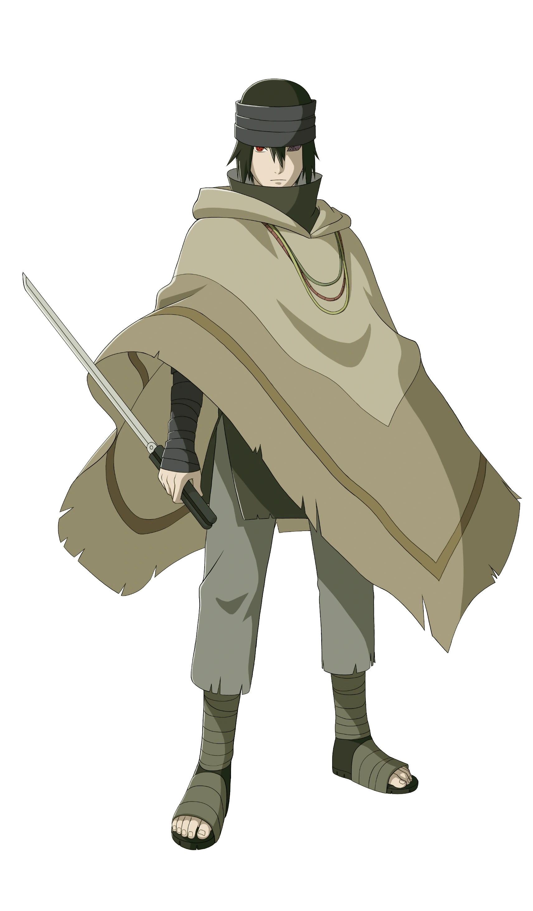

<!--
  ╔══════════════════════════════════════════════════════════════════════╗
  ║   SHINOBI WEEKLY :: THE AVISHEK SADHUKHAN ISSUE                        ║
  ║   A magazine-style GitHub profile.                                     ║
  ║   Place in repo  psudocode-monk/psudocode-monk  as  README.md          ║
  ║   Character photos live in  assets/characters/  (committed to repo).   ║
  ║   Text-over-image = capsule-render banners (GitHub strips CSS).        ║
  ╚══════════════════════════════════════════════════════════════════════╝
-->

<!-- ═══════════════════ MAGAZINE COVER (text baked onto banner) ═══════════════════ -->
<p align="center">
  
</p>

<!-- Masthead strip -->
<p align="center">
  
  
  
  
</p>

<!-- Cover character line-up: the real cast across the cover -->
<p align="center">
  
  
  
  
  
  
  
</p>

<h3 align="center">
  
</h3>

<p align="center">
  <a href="https://linkedin.com/in/avishek"></a>
  <a href="https://github.com/psudocode-monk"></a>
  <a href="mailto:avi.codemail@gmail.com"></a>
  
</p>

<!-- Table of contents ribbon -->
<p align="center">
  
</p>

---

<!-- ═══════════════════ FEATURE 1 — NINJA REGISTRATION (Naruto) ═══════════════════ -->
<table border="0">
<tr>
<td width="32%" align="center" valign="top">
  
  <br><sub><b>🍥 NARUTO UZUMAKI</b><br><i>cover model</i></sub>
</td>
<td width="68%" valign="top">

### 🍥 NINJA REGISTRATION — `忍者登録`

> *“A ninja never gives up on a failing build.”*

```yaml
Shinobi:        Avishek Sadhukhan
Codename:       psudocode-monk
Affiliation:    Alt Digital Technologies, Noida
Specialization: Java & Spring Boot Ninjutsu + iOS Taijutsu
Chakra Nature:  ☕ Java  |  🌱 Spring Boot  |  🐦 Swift
Kekkei Genkai:  RESTful APIs & Distributed Systems
Current Arc:    MCA @ KNIT Sultanpur (CGPA 8.7)
Nindo:          "Ship clean, ship reliable."
```

The headline shinobi of this issue — a developer who channels chakra through
Spring Boot endpoints and summons microservices at will.

</td>
</tr>
</table>

<p align="center">
  
</p>

<!-- ═══════════════════ FEATURE 2 — ACADEMY (Kakashi) ═══════════════════ -->
<table border="0">
<tr>
<td width="68%" valign="top">

### 📜 ACADEMY ARC — Education

A disciplined trainee rising through Konoha's academy ranks with sharpened
fundamentals and a near-perfect chakra score.

| 🏯 Academy | 🎓 Training | 📊 Chakra Score | 🗓️ Timeline |
|:--|:--|:--:|:--:|
| **KNIT Sultanpur** · Sultanpur, UP | Master of Computer Applications | **CGPA 8.7** | Sept 2024 – May 2026 |

</td>
<td width="32%" align="center" valign="top">
  
  <br><sub><b>🎓 KAKASHI HATAKE</b><br><i>academy sensei</i></sub>
</td>
</tr>
</table>

<p align="center">
  
</p>

<!-- ═══════════════════ FEATURE 3 — MISSIONS (Minato) ═══════════════════ -->
<table border="0">
<tr>
<td width="32%" align="center" valign="top">
  
  <br><sub><b>🌀 MINATO NAMIKAZE</b><br><i>squad leader</i></sub>
</td>
<td width="68%" valign="top">

### ⚔️ MISSION LOG — Software Developer
**Alt Digital Technologies** · Noida, UP — `Jul 2026 – Present` · **S-RANK**

- 🍃 **Shadow-Clone APIs** — built & maintained production **iOS apps in Swift**, wiring RESTful APIs & async data flows; shipped **10+ backend API integrations** for cross-client data consistency.
- 🌀 **Rasengan Backend** — engineered backend services with **Java & Spring Boot** (Spring MVC, Spring Security): modular REST APIs, controllers, services, DTOs, bean validation, exception handling, JWT auth flows & third-party integrations across **10+ endpoints**.
- 👁️ **Sharingan Debugging** — traced **iOS → Spring Boot → Azure** flows via logs, API traces & payloads; root-cause analysis on critical workflows.
- 🤝 **Team Seven Synergy** — code reviews, Git, Agile/Scrum, testing, defect resolution & CI/CD for stable, maintainable releases.

</td>
</tr>
</table>

<p align="center">
  
</p>

<!-- ═══════════════════ FEATURE 4 — PROJECTS (Itachi + Sasuke centerfold) ═══════════════════ -->
<table border="0">
<tr>
<td width="50%" valign="top" align="center">

  
  <br><sub><b>🍜 FEATURED BY ITACHI</b></sub>

  ### 🍜 MAACH BHAAT
  `Java · Spring Boot · MongoDB · REST`
  <br><i>Aug – Sept 2025</i>

  Short-form **food-video sharing platform** — upload recipe & showcase
  videos, save favorites, explore food-partner content.
  - 🌀 RESTful APIs with Spring Boot
  - 🗄️ MongoDB data modeling
  - ♻️ Reusable service & data-access layers

</td>
<td width="50%" valign="top" align="center">

  
  <br><sub><b>🍱 FEATURED BY SASUKE</b></sub>

  ### 🍱 CRAVEZY
  `React.js · Redux Toolkit · Tailwind`
  <br><i>Jul 2025</i>

  Responsive **food-delivery web app** — browse menus, manage cart,
  real-time totals.
  - ⚛️ Reusable React components
  - 🧭 Centralized Redux Toolkit state
  - 🔁 Consistent cart & menu data flow

</td>
</tr>
</table>

<p align="center">
  
</p>

<!-- ═══════════════════ FEATURE 5 — JUTSU ARSENAL (Gaara) ═══════════════════ -->
<table border="0">
<tr>
<td width="30%" align="center" valign="top">
  
  <br><sub><b>� GAARA</b><br><i>chakra arsenal</i></sub>
</td>
<td width="70%" valign="top">

### 🌪️ JUTSU ARSENAL

**🔥 Languages**
<br>


**🌱 Java Ecosystem & Backend**
<br>


**🗄️ Databases**
<br>


**🏗️ System Design**
<br>


**☁️ Cloud & DevOps**
<br>


**📡 Observability & 🧪 Testing**
<br>


</td>
</tr>
</table>

<!-- Chakra chart -->
### 📊 CHAKRA DISTRIBUTION — Skill Meter

```text
Java / Spring Boot      ███████████████████░  95%  🌀 Rasengan Mastery
System Design & Arch.   ████████████████░░░░  82%  🏗️ Konoha Architect
Databases (SQL/NoSQL)   █████████████████░░░  88%  🗄️ Scroll Keeper
Cloud & DevOps          ███████████████░░░░░  78%  ☁️ Summoning Jutsu
iOS / Swift             ██████████████░░░░░░  72%  📱 Mobile Taijutsu
Observability           █████████████░░░░░░░  70%  👁️ Byakugan Vision
```

<p align="center">
  
</p>

<!-- ═══════════════════ FEATURE 6 — STATS (data spread) ═══════════════════ -->
<p align="center">
  
  
</p>
<p align="center">
  
</p>
<p align="center">
  
</p>

<!-- Contribution snake -->
### 🐍 THE TOAD SAGE'S CONTRIBUTION TRAIL
<p align="center">
  
</p>

<!-- Jiraiya wisdom quote -->
<table border="0">
<tr>
<td width="24%" align="center" valign="middle">
  
  <br><sub><b>🐸 JIRAIYA</b><br><i>editor's note</i></sub>
</td>
<td width="76%" valign="middle">
  <br>
  
</td>
</tr>
</table>

---

<!-- ═══════════════════ BACK COVER — CONNECT ═══════════════════ -->
<p align="center">
  
</p>

<p align="center">
  <a href="mailto:avi.codemail@gmail.com"></a>
  <a href="https://linkedin.com/in/avishek"></a>
  <a href="https://github.com/psudocode-monk"></a>
</p>

<p align="center"><i>⭐ NEXT ISSUE: new projects, new jutsu. Star the repo so you don't miss it. Dattebayo! 🍥</i></p>
